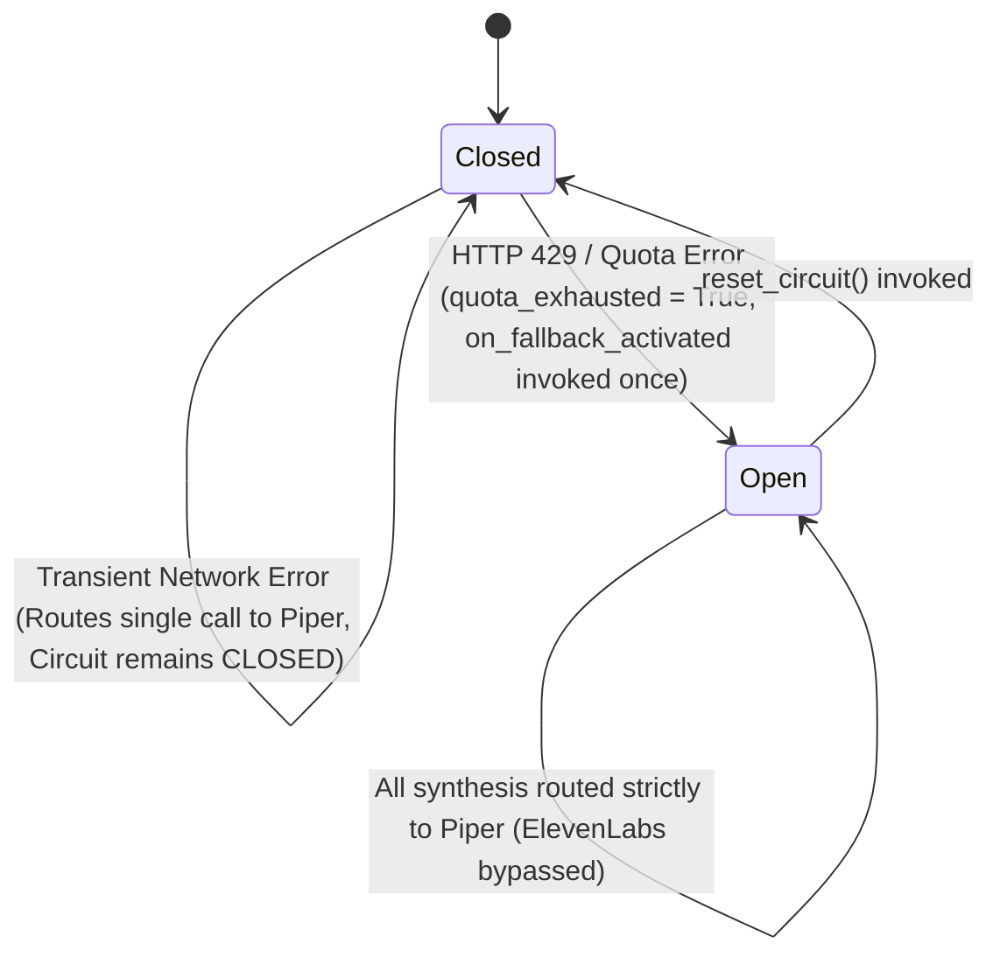

# Viernes: Audio Output, TTS Synthesis & Resilience Architecture

**Author:** Agente A (Audio Output, Síntesis TTS y Resiliencia)  
**Status:** Approved & Implemented  
**Date:** 2026-11-01  

---

## 1. Architectural Overview & Boundaries

The Viernes Voice Assistant relies on an abstracted, resilient Audio Output and Text-to-Speech (TTS) layer designed around Clean Architecture principles. High-fidelity cloud neural speech synthesis is balanced with local offline fallback guarantees, ensuring zero conversational downtime even under network partitions or API quota exhaustion.

```mermaid
graph TD
    UserReq[Response Text from Brain] --> ResilientTTS
    
    subgraph Circuit Breaker
        ResilientTTS -->|Circuit Closed / 200 OK| ElevenLabsProvider[ElevenLabs Provider]
        ResilientTTS -->|Circuit Open or HTTP 429| PiperProvider[Piper Local ONNX Provider]
    end
    
    ElevenLabsProvider -->|MP3 Streaming / Chunks| TempStorage[Secure VIERNES_TEMP_DIR (0o700)]
    PiperProvider -->|WAV Synthesis Subprocess| TempStorage
    
    TempStorage --> AudioPlayer[AudioPlayer Engine]
    
    subgraph Audio Backend Resolution
        AudioPlayer --> mpv[1. mpv --no-video --no-terminal]
        AudioPlayer --> pwplay[2. pw-play PipeWire]
        AudioPlayer --> paplay[3. paplay PulseAudio]
        AudioPlayer --> aplay[4. aplay ALSA Fallback]
    end
```

---

## 2. Circuit Breaker State Machine

The Circuit Breaker pattern protects both the user experience and external API quota:



### Key Circuit Guarantees:
1. **Zero Flapping:** Once quota exhaustion is detected (HTTP 429, `quota_exceeded`, `insufficient_credits`), `self.quota_exhausted` is set to `True`. Subsequent calls bypass ElevenLabs completely without attempting further network requests.
2. **Transient vs Terminal Differentiation:** Transient connection issues (e.g. socket read timeouts) route the specific call to Piper without permanently opening the circuit, allowing automatic recovery on subsequent calls.
3. **Thread-Safe State Transitions:** Thread synchronization via `threading.Lock` guarantees that even under burst concurrency, `on_fallback_activated` is dispatched exactly once.

---

## 3. Concurrency & Thread-Safety Model

Voice assistants often handle asynchronous streaming, audio playback, and barge-in listeners across background threads. Both `ResilientTTS` and `AudioPlayer` are hardened for thread-safety:

- **Atomic State Checks:** `ResilientTTS.synthesize` uses a mutual exclusion lock to inspect and flip the circuit state.
- **Process List Synchronization:** `AudioPlayer._active_processes` is guarded by an internal lock, preventing race conditions or `RuntimeError: list changed size during iteration` when background playback triggers while an interruption/stop event arrives.
- **Idempotent Teardown:** `AudioPlayer.stop_all()` can be called multiple times across threads without raising exceptions or leaving dangling processes.

---

## 4. Subprocess Lifecycle & Barge-in Latency

Audio playback is decoupled from the main event loop to keep microphone capture active:

- **Dynamic Backend Resolution:** Auto-detects in priority: `mpv` > `pw-play` > `paplay` > `aplay`.
- **Stream Silencing:** All backend subprocesses redirect `stdout` and `stderr` to `subprocess.DEVNULL`, keeping standard terminal output and systemd journals clean.
- **Zombie Process Prevention:** Finished processes (`proc.poll() is not None`) are pruned on each playback invocation and termination.
- **Barge-in SLA (<50ms):** `stop_all()` immediately issues `SIGTERM` to active player processes, escalating to `SIGKILL` if a backend does not exit within 200ms.
- **Piper Subprocess Timeout (15s):** Local ONNX synthesis via `PiperProvider` enforces a 15-second timeout on `subprocess.communicate`. If the process hangs, it is killed with `SIGKILL` and raises `TimeoutError`.

---

## 5. Security & Isolation Model

- **Secret Redaction:** `ELEVENLABS_API_KEY` is redacted across all string representations (`repr`), logging statements, and diagnostics (formatted as `sk_***1234`).
- **Temporary Directory Hardening:** `/tmp/viernes` is created with user-only permissions (`0o700`), preventing local multi-user eavesdropping or symlink tampering.
- **Environment Exclusions:** `.env` is verified in `.gitignore`, and only `.env.example` with documented non-sensitive placeholders is committed.

---

## 6. systemd User Daemon Service

Viernes runs as a resident user-level service (`systemd --user`):

- **Unit File:** `viernes.service` (`Type=simple`, `Restart=on-failure`, `RestartSec=5s`).
- **Isolation:** Executed via `uv run python -m viernes.main`.
- **Session Forwarding:** Passes `DISPLAY`, `WAYLAND_DISPLAY`, `XDG_RUNTIME_DIR`, and `PULSE_SERVER` for seamless graphical and audio integration.
- **Termination Handlers:** Native `SIGINT` and `SIGTERM` handlers ensure orderly teardown before process exit.
